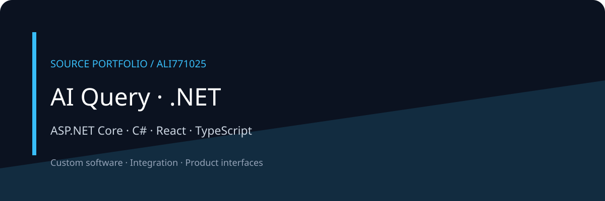

# AI Query · .NET



A layered .NET 8 reporting backend with an accompanying React query workspace.

[معرفی فارسی](docs/README.fa.md) · [Architecture](docs/ARCHITECTURE.md) · [Discuss a project](https://github.com/Ali771025)

## What this portfolio shows

- Domain and application layers separated from infrastructure and API delivery.
- Contracts and application interfaces for AI-backed query workflows.
- A background worker and browser UI accompany the HTTP API.

## Technology

ASP.NET Core · C# · React · TypeScript

## Local orientation

These are source-derived starting commands, not a verified deployment recipe. Review configuration and dependencies first.

```bash
cp src/AiQuery.Presentation.Api/appsettings.example.json src/AiQuery.Presentation.Api/appsettings.json
# Edit the local configuration before starting the API.
dotnet restore AiQuery.sln
dotnet run --project src/AiQuery.Presentation.Api
```

All credentials, infrastructure and datasets must be supplied independently. See configuration modules for required variables. Binary assets and customer documents are deliberately absent; some visual asset references may need replacements.

Frontend orientation: `cd frontend_ai-query-ui/ai-query-ui && npm ci && npm run dev`.

## Edition and verification

This is a compact public source edition. Original history, contracts, private documents, databases, logs, generated output and dependency directories are excluded. No build, test, deployment, security certification or production-readiness claim is made for this edition. Public documentation and diagrams describe source structure; they are not application screenshots.

## Work together

For a related product, integration or custom workflow, [contact Ali through GitHub](https://github.com/Ali771025). Share your intended users, workflow and integration needs to scope the work.

No new license grant is added by this portfolio edition. Third-party components remain subject to their own terms.
