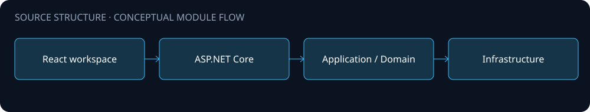
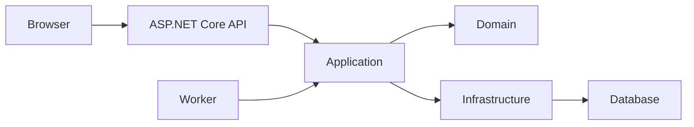

# Architecture

A layered .NET 8 reporting backend with an accompanying React query workspace.

The diagram is a source-level orientation. Arrows describe intended module relationships; integration availability and end-to-end behavior were not validated for this public edition.

## Boundaries

- Domain and application layers separated from infrastructure and API delivery.
- Contracts and application interfaces for AI-backed query workflows.
- A background worker and browser UI accompany the HTTP API.

## Configuration and data

Configure your own environment and service endpoints. Never place API keys, production connection strings, customer records or uploaded documents in this repository. Public source omits operational assets and does not include a production deployment guarantee.
